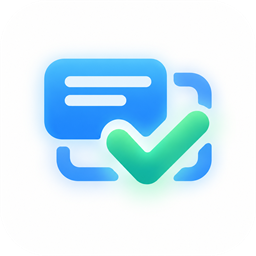

# Corkboard

**桌面看板，一块板子管一件事**

> [!NOTE]
> Corkboard 以 GNU GPLv3 协议发布！您可以修改和再发布源代码，但再发布的衍生作品也必须遵循 GNU GPLv3

## Corkboard

Corkboard 是常驻桌面的看板应用

## 软件功能

### 作业板

- **布置作业**：富文本内容支持加粗、斜体、下划线、删除线、文字颜色与高亮、列表、缩进、行距、对齐、字号字体，可插入表格与图片
- **手写便签**：鼠标与触控都能写，带笔锋与自动矫正，内容框可拖宽拖高
- **分类与标签**：科目、二级分类与快捷标签，布置时从设置好的列表里挑
- **截止日期**：填了才管用，卡片上按「今天 / 明天 / 过期 N 天」显示，过期标红
- **两种排布**：单列居中，或按窗口宽度分栏，区块各自定高；同科目合成一个区块，标题可拖动排序
- **自动清理**：到设定时刻（默认每天 8:00）把过了截止日期的作业从板面收起，数据原地保留
- **时空回放**：按历史日志重放板子在任意时刻的样子，删掉的作业、编辑前的旧内容都能找回来，可一键「还原到此刻」
- **导出**：图片导成一张长图或直接复制到剪贴板；表格导成 Excel 能直接打开的 xlsx，一行一条作业，按科目分块、状态标色、真日期单元格都可配
- **收纳**：一键收成屏幕角落一颗浮钮，点一下放回来

### 更多功能

- 开发计划进行中

## 技术栈

| 层次 | 选择 |
| --- | --- |
| 界面 | Avalonia 12 + FluentAvaloniaUI |
| 运行时 | .NET 10 桌面 |
| 架构 | MVVM（CommunityToolkit.Mvvm），Shared ← Core ← App ← Desktop 单向依赖 |
| 平台 | Windows（当前发行）、Linux、macOS |

## 下载与更新

- [GitHub Releases](https://github.com/SECTL/Corkboard/releases) 提供各版本的发行包与更新说明
- 每个架构提供 **full（自包含）** 与 **light（依赖框架）** 两种便携包：解压即用，根目录是 `CorkboardLauncher`，新版本装在 `app-*` 目录里切换
- Windows 另有安装包，安装后自动创建开始菜单快捷方式，桌面快捷方式可选
- light 版需要先安装 [.NET 10 桌面运行时](https://dotnet.microsoft.com/download/dotnet/10.0)；安装包已自带运行时
- 安装包尚未使用受信代码签名证书，首次运行时 Windows SmartScreen 可能提示「未知发布者」，选择「更多信息 → 仍要运行」即可

## 许可证与第三方声明

- Corkboard 使用 [GNU GPLv3](LICENSE) 协议发布
- 第三方组件、版权与分发审查信息见 [THIRD-PARTY-NOTICES.md](THIRD-PARTY-NOTICES.md)

## 贡献者和特别感谢

感谢每一位为 Corkboard 提交代码、报告问题、完善文档和提供反馈的贡献者。头像由 GitHub 贡献者数据动态生成，点击可前往 [GitHub 贡献者页面](https://github.com/SECTL/Corkboard/graphs/contributors) 查看完整统计

## 支持与社区

- [爱发电支持](https://afdian.com/a/lzy0983)
- [Bilibili 主页](https://space.bilibili.com/520571577)
- [问题反馈](https://github.com/SECTL/Corkboard/issues)
- [思拓创联官网](https://sectl.cn)

## Star History

<a href="https://www.star-history.com/?repos=SECTL%2FCorkboard&type=date&legend=top-left">
 <picture>
   <source media="(prefers-color-scheme: dark)" srcset="https://api.star-history.com/chart?repos=SECTL/Corkboard&type=date&theme=dark&legend=top-left" />
   <source media="(prefers-color-scheme: light)" srcset="https://api.star-history.com/chart?repos=SECTL/Corkboard&type=date&theme=light&legend=top-left" />
   
 </picture>
</a>

**Copyright © 2025 - 2026 SECTL**
